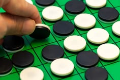
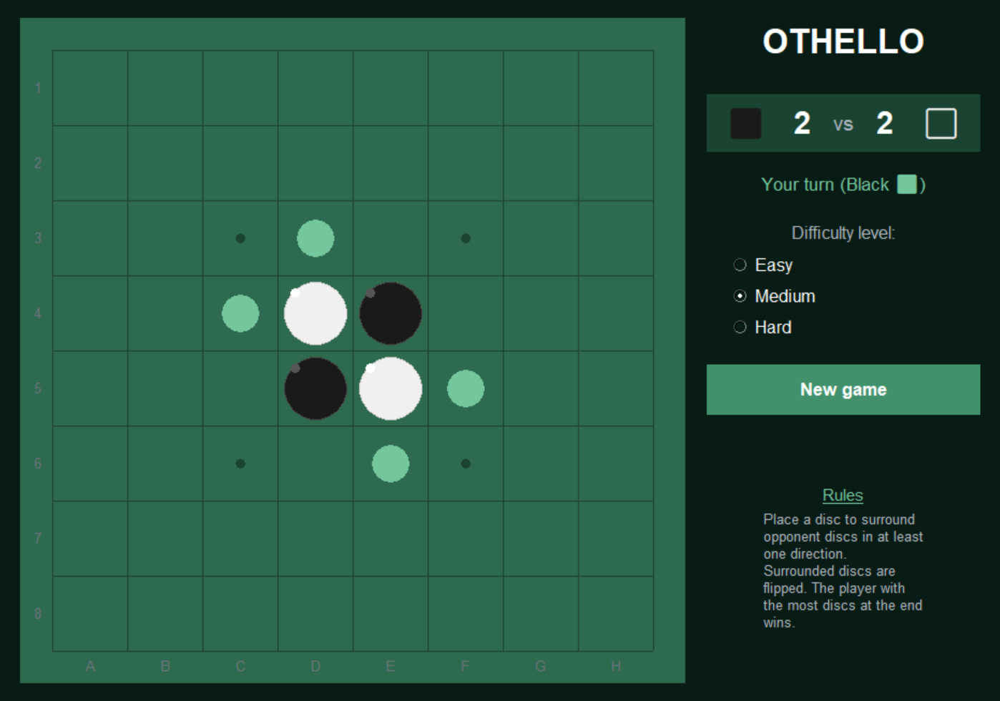

# OTHELLO PROJECT
Author: Aureva21

## Context and Objective


This project implements the game of Othello (Reversi) in Python, playable against the computer with three difficulty levels and a Tkinter graphical interface. The computer's strategy relies on the minimax algorithm with alpha-beta pruning, together with a position-evaluation score that depends on the heuristic (and therefore on the chosen difficulty level).
Project carried out as part of my 2nd year at CPES, during the course on two-player games.

## Game Logic

The board is a list of 8 lists of 8 integers, with three constants: `EMPTY`(0), `BLACK`(1) and `WHITE`(2). The main functions are:

- `create_board()`: sets up the starting position
- `flipped_discs()`: the core function, which scans the 8 directions to determine which discs are flipped by a move
- `is_valid_move()` and `valid_moves()`: move validation
- `play_move()`: applies a move and flips the discs
- `copy_board()`: essential to simulate moves without modifying the real game state
- `count_discs()`, `game_over()` and `winner()`: scoring and end-of-game detection

## Computer Strategy

There are three difficulty levels, each with its own search depth and heuristic. I chose to combine increasing depth with increasingly sophisticated heuristics so that the levels are consistent with each other, and capped the depth at 6 to keep computation times reasonable.

- **Easy (depth 2):** maximizes the disc difference between the computer and the player. This is a naive strategy: the number of discs at a given moment is a poor predictor of the final result.
- **Medium (depth 4):** score based on three positional criteria: 1 point per available valid move (mobility), 3 points per occupied edge square and 10 points per occupied corner, then the difference between the player's and the opponent's scores.
- **Hard (depth 6):** combines three components:
  - a positional score from a weight matrix (`POSITION_WEIGHTS`): corners at +100, squares adjacent to corners down to -50
  - mobility (difference in number of available moves)
  - a +10 / -10 bonus/penalty per corner controlled

  These components are combined as a weighted sum (×5 for position, ×3 for mobility, ×10 for corners). The weights were tuned empirically through repeated tests: large weights create wide gaps between the scores of different states.

## Minimax with Alpha-Beta Pruning

`alphabeta()` recursively explores the game tree. The computer (MAX node) maximizes its score, while the human player (MIN node) minimizes it. As soon as `alpha >= beta`, the branch is pruned.

A special case specific to Othello is handled: if a player has no available move, they pass and the search continues with the other player (the depth is still decremented, which guarantees termination).

`choose_move()` orchestrates the whole process: it iterates over the valid moves, simulates each one on a copy of the board, calls `alphabeta()` and returns the move with the best score.

## Usage

To launch the game, simply run the file: it contains all the necessary functions. Requirements: Python 3 with Tkinter (included in most Python installations, no other dependency). The game is controlled by clicking on the Tkinter interface.

```bash
python Othello_project_code.py
```

At launch, a window asks who starts. Black always plays first (official rule), so the player who starts plays Black. Your valid moves are shown in light green. The difficulty level is set in the side panel and defaults to Medium. To play at another level, select the desired level in the side panel; it applies to the computer's next move, and clicking **"New game"** lets you start a fresh game at that level.

## Known Limitations
The search runs in the main thread, so the interface may freeze for a few seconds at the Hard level, when the computer is calculating its move.
